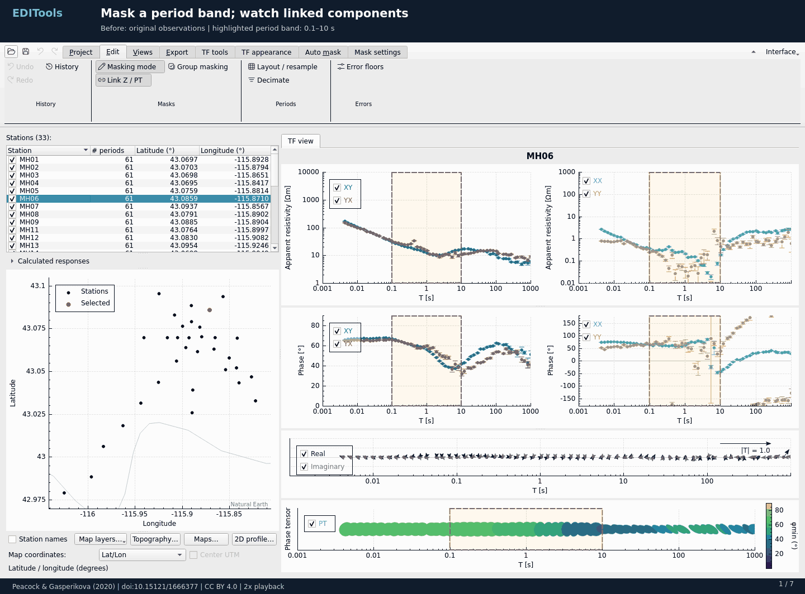

# EDI Tools

A simple GUI tool to work with large collections of [Magnetitelluric](https://en.wikipedia.org/wiki/Magnetotellurics) data in the Electrical Data Interchange (EDI) format, which is [SEG standard for MT and EMAP data](https://pubs.usgs.gov/of/2003/of03-056/Data/Edistd.doc).



*Feature walkthrough at 2× playback speed (55 seconds).* Demonstrates masking and undo, geographic layers and topography downloads, and profile analysis with phase-tensor ellipses and rose diagrams.

Data reference: Peacock, J., & Gasperikova, E. (2020), [Magnetotelluric Data from Mountain Home, ID](https://doi.org/10.15121/1666377), USGS / Geothermal Data Repository, licensed under [CC BY 4.0](https://creativecommons.org/licenses/by/4.0/). The demo uses a subset of the public survey; see the [animation credits](docs/media/editools-workflow-credits.txt) for data preparation and map-source attribution.

## Features

- View transfer functions in a single layout: XY/YX and XX/YY columns, induction arrows, and phase-tensor ellipses
- Work in named, reorderable analysis tabs with TF view pinned first
- Configure ranges, colors, colormaps and marker sizes in a contextual ribbon
- Browse a sortable station table with period counts and coordinates matching the map
- Assign error floors (with a proper error propagation from impedances to derived quantities such as apparent resistivity, phase or phase tensor)
- Decimate data
- Export a PDF survey report or a PNG image of the current plots
- Mask data with paired XY/XX and YX/YY edits, optional Z/PT links, automatic previews, and undo/redo
- Save/load projects with masks, open tabs, view settings and geographic profile lines preserved
- Export selected data in supported inversion formats.
- Overlay computed inversion responses on observed data.
- Load, display and export topography, including optional DEM downloads.
- Draw profile corridors for resistivity/phase and tensor pseudosections, strike roses and station extraction.

## Dependencies

- A C++17 compiler
- Qt >= 6.8 (Widgets, PrintSupport and Network)
- Eigen >= 3
- CMake >= 3.16
- Boost >= 1.84
- QCustomPlot >= 2.1.1
- PROJ (UTM coordinate conversion)
- GDAL >= 3.7 (GeoTIFF input, raster reprojection and export)

Command icons use [Microsoft Fluent UI System Icons](https://github.com/microsoft/fluentui-system-icons)
under the [MIT license](resources/icons/fluent/LICENSE). Only the required SVGs are bundled;
they follow the application palette and require no additional UI framework.

## Building

The app builds from this repository on Linux with GCC and on Windows with
Visual Studio C++. Install the dependencies above, then configure a Release build:

```sh
cmake -S . -B build/Release -DCMAKE_BUILD_TYPE=Release \
  -DCMAKE_PREFIX_PATH=/path/to/dependency-prefix \
  -DQCUSTOMPLOT_PATH=/path/to/qcustomplot -DEIGEN_PATH=/path/to/eigen
cmake --build build/Release --config Release
```

The build shares the data and plotting libraries between the app and tests.
Run checks with `ctest --test-dir build/Release -C Release --output-on-failure`.
See the [development guide](docs/development.md) for the repository layout, view
lifecycle, shared map and ribbon ownership, saved-state conventions, and checks.

### Rebuilding v1.0

Check out the `v1.0` tag. The release uses Qt 6.8.3, Boost 1.84.0, GDAL 3.10.2,
PROJ 9.5.1, QCustomPlot 2.1.1 and Eigen 5.0.0. Exact Conda build environments
are recorded in [linux-v1.0.txt](packaging/linux-v1.0.txt) and
[windows-v1.0.txt](packaging/windows-v1.0.txt). Create an environment using
`conda create -n editools --file packaging/linux-v1.0.txt` (or the Windows file),
then `conda activate editools`. On Windows, use a Visual Studio 2022 x64 Native
Tools command prompt; the release used MSVC 19.44. The Linux environment supplies GCC 14.3.

Download the two compile-time source libraries with Python 3.9 or newer, then
extract them using CMake (these commands work on both platforms):

```sh
python scripts/fetch_sources.py
cmake -E make_directory build/vendor
cmake -E chdir build/vendor cmake -E tar xzf ../sources/QCustomPlot.tar.gz
cmake -E chdir build/vendor cmake -E tar xzf ../sources/eigen-5.0.0.tar.gz
```

For the configure command above, use `-G Ninja`,
`-DQCUSTOMPLOT_PATH=build/vendor/qcustomplot` and
`-DEIGEN_PATH=build/vendor/eigen-5.0.0`. Set `CMAKE_PREFIX_PATH` to the active
environment (`$CONDA_PREFIX` on Linux, `%CONDA_PREFIX%/Library` on Windows).
With the pinned Linux environment, also pass
`-DOPENGL_INCLUDE_DIR="$CONDA_PREFIX/include"` to use its OpenGL headers.
Use a fresh build directory when changing compilers or environments.

When running the unbundled Windows build or CTest, make the pinned environment's
runtime DLLs and Qt plugins available. For this Qt build, set
`QT_PLUGIN_PATH=%CONDA_PREFIX%\Library\lib\qt6\plugins` in the activated command
prompt. Use a matching MSVC runtime; an old build directory may contain runtime
DLLs or a `qt.conf` that a fresh directory does not have. Portable packages
include their own runtime libraries and plugin configuration.

[sources-v1.0.json](packaging/sources-v1.0.json) records verified upstream source
URLs and SHA-256 hashes, plus the exact distributed runtime packages. The source
downloader checks every hash; `--dependencies` also retrieves the larger runtime
library source archives when needed. Dependency build recipes and patches are
in `info/recipe` inside the listed Conda packages: `.conda` files are ZIP containers
whose `info-*.tar.zst` member contains this metadata; older packages use `.tar.bz2`.
The app sources, dependency source locations and build instructions are available
from the repository; no combined source download is required to build the app.

### Portable packages

Extract the entire package before starting `EDITools` on Linux or `EDITools.exe`
on Windows. No compiler, Python or separate Qt installation is needed. Linux
requires an x86-64 desktop with glibc and an X11 server (XWayland or WSLg works).
Keep the bundled libraries, plugins and `share` directory beside the executable.
Offline Natural Earth map layers are included in `share/natural-earth`.
Downloaded terrain and online map tiles are not included.

Windows uses Qt's native Windows 11 controls on Windows 11, with the platform
style selected automatically. The package includes the style plugins; keep the
`plugins/styles` directory when moving or redistributing the app.

`scripts/package_portable.py` assembles a release executable and its matching
Conda runtime into a fresh directory. It requires Python with PyYAML, plus
`patchelf` on Linux or `pefile` for Windows. Run it with `--help` for the required
build, dependency-cache and source-directory arguments. Build each executable
on its target OS; Windows DLL inspection can also run from WSL.
Pass `--map-data` the directory generated by `scripts/pack_natural_earth.py`;
the packager verifies its checksums and includes its notice in `licenses.zip`.
Set `--source-ref` to the matching public tag or commit (for example `v1.0`).

Runtime packages contain the app, required libraries and data, a short
`README.txt`, and `licenses.zip`. The archive contains the application license,
dependency notices and version information; keep it with the package. It need
not be extracted to run the app. Documentation stays in this repository, and
release checksums are supplied beside the download archives. Releases link to
the matching repository tag and dependency source index. Keep these source
locations and build instructions available when redistributing the binaries.
The libraries remain dynamically linked and replaceable.

## Usage

Read the [user guide and full table of contents](docs/README.md).

- [Getting started](docs/getting-started.md)
- [Transfer-function view](docs/getting-started.md#transfer-function-view)
- [Editing and masking](docs/editing.md)
- [Response analysis](docs/analysis.md)
- [Maps and geographic layers](docs/maps.md)
- [Profile analysis](docs/profiles.md)
- [Survey reports](docs/reports.md)
- [Period layout and resampling](docs/periods.md)
- [Coordinates, topography and data export](docs/coordinates-export.md)

## Contributing

Feel free to create an issue or pull request in case you want to report a problem or contribute/fix the code.
